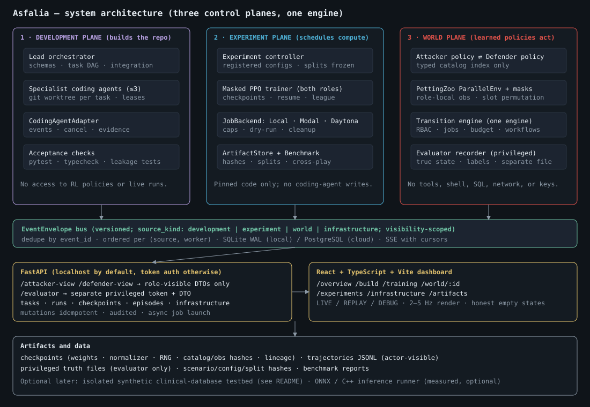
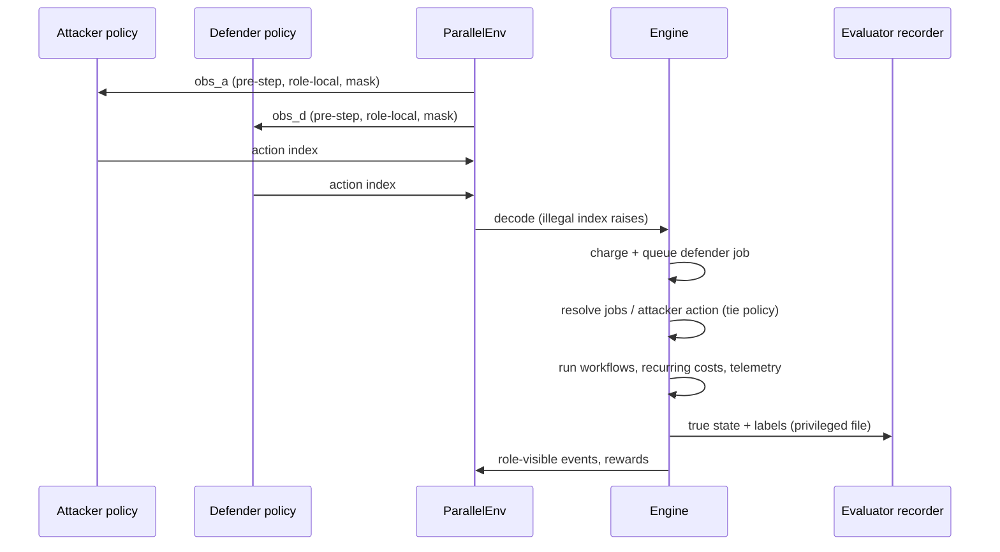
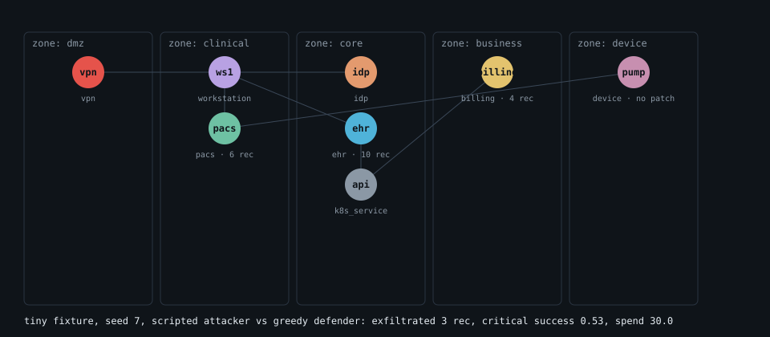
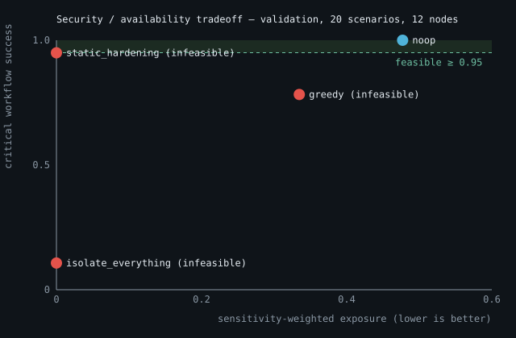
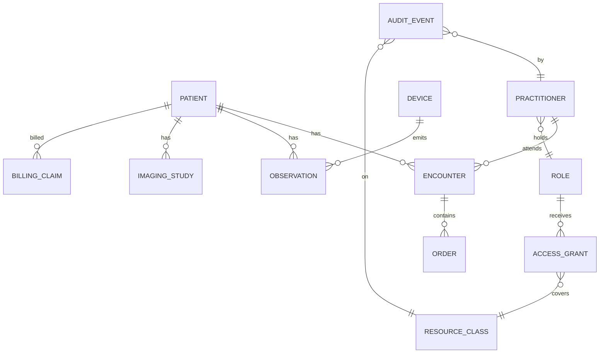

# Asfalia

**ἀσφάλεια (asfáleia)** — Greek for *security, safety, certainty, firmness.*

Asfalia is a reproducible research platform for training **attacker** and **defender** reinforcement-learning policies
in a **synthetic hospital**, then measuring security against the thing a hospital exists to protect: uninterrupted
clinical work. The simulator, task suite, trajectories, and benchmark are the product; learned policies demonstrate
that the benchmark is useful.

> **HARD RULE — commit at least every 4 minutes.** Every contributor (lead, specialist agents, humans) commits work in
> progress at least once every 4 minutes of active work, and before any command expected to run longer. See `CLAUDE.md`.
> Never read, print, or commit `.env` or API keys.

---

## 1. Problem statement

Hospitals are attractive targets (dense sensitive records, flat legacy networks, unpatchable medical devices) and
unusually hard to defend, because **security controls are not free for care**. Enforcing MFA adds latency to an
emergency chart lookup; isolating a segment can cut a radiologist off from imaging; reimaging a workstation takes it
off the ward. A defender that "wins" by shutting everything down has failed.

Three gaps this project addresses:

1. **Security RL ignores care costs.** Most attacker/defender simulators score confidentiality and treat availability
   as an afterthought or an arbitrary penalty ("MFA annoys users"). In a hospital the cost must *emerge* from simulated
   clinical workloads (chart lookup, image retrieval, device telemetry, billing sync, emergency access), computed from
   actual permissions and service state.
2. **No open benchmark ties security outcomes to workflow availability under budgets.** Scalar return hides
   infeasible policies. Asfalia reports security, availability, and cost separately and marks policies that violate
   the availability constraint instead of burying them in an average.
3. **Transfer is assumed, not tested.** The hypothesis is that attacker and defender trained separately on small
   randomized "school" worlds, then dropped into a shared hospital world, generalize or learn faster than training from
   scratch. We test that against equal-total-budget scratch baselines; we do not assume it.

**Not claimed:** that this is novel without comparison to related systems (e.g. CyberBattleSim), that real security data
is unavailable, that partial observability requires RL, or that synthetic results transfer to real hospitals. This is a
graph simulator with synthetic assets and abstract transitions — not a hospital replica and not a HIPAA assessment.

---

## 2. Technical framework

### 2.1 One engine, three environments
A single transition engine with three task configurations:

| Environment | Purpose |
| --- | --- |
| Attacker school | Small randomized worlds, scripted/frozen defenders; curriculum over discovery → access → collection → simulated exfiltration |
| Defender school | Small randomized worlds, scripted incidents + benign workload; posture, containment, remediation, recovery, budget |
| Shared hospital | Both trained policies act against each other under access rules, budgets, workflow dependencies, partial observability |

"Moving" an agent means loading weights, observation normalizer, recurrent-state spec, and the versioned
action/observation vocabulary into a compatible adapter. Incompatible checkpoints are rejected with a readable error.

### 2.2 World model
- **Graph:** nodes (EHR, PACS, workstations, billing, IdP, VPN, k8s services, devices) with zone, records, sensitivity,
  patchability, abstract vulnerability flags, logging, encryption, credentials. Edges are explicit: *reach*, *trust*,
  and *depends* (service dependency ≠ network reachability ≠ identity trust).
- **Identity ≠ machine compromise:** roles, scoped credentials, sessions, MFA. Network access is not authorization;
  encryption at rest does not stop an authorized compromised session.
- **Semantics that matter:** patching blocks *future* transitions but does not remove existing compromise; isolation
  blocks edges but neither erases compromise nor restores services; revoking sessions leaves implants; reimage clears
  implants but not already-held credentials. Some devices are unpatchable (a scenario assumption).
- **Workloads:** each workflow has a rate, path, role, deadline, and criticality. Bounded, audited emergency overrides.
- **Timing:** a tick is abstract. Defender actions are jobs with duration and spend; both roles choose from the same
  pre-step observation; resolution order is a documented, configurable tie policy (default `defender_first`), and
  its sensitivity is measurable (`benchmark --tie-sensitivity`).

### 2.3 Actions, masks, observations
- **Attacker:** wait, discover, probe, attempt_initial_access, attempt_privilege_change, move, collect, exfiltrate.
- **Defender:** wait, enable_mfa, restrict_role, revoke_session, rotate_credential, patch, isolate,
  restore_connectivity, increase_logging, quarantine, reimage, restore_service.
- `Discrete(1 + types × 64)` over padded target slots with a per-episode slot permutation; wait is always legal.
  Masks use only role-observable information, so a mask never reveals a hidden vulnerability or compromise. Actions
  that fail on hidden prerequisites are observable, costed transitions; invalid indices raise.
- Defender telemetry is noisy, delayed, or missing, and false positives are indistinguishable from real alerts.
- Evaluator truth lives in a separate privileged recorder. Leakage tests perturb hidden state and require identical
  observations and masks.

### 2.4 Objective
Illustrative, uncalibrated, configurable:

```
r_defender = -5·Δunique_sensitive_exfil_frac − 2·critical_workflow_fail_frac − 1·noncritical_fail_frac
             − 0.2·normalized_spend − 0.1·normalized_added_latency
```

Fixed horizons (no early termination to dodge downtime), hard budget cap, every defender term ≤ 0 so cycling controls
cannot profit, each synthetic record counted once. Feasibility is reported separately: critical-workflow success
must be ≥ 0.95 (a benchmark parameter, not a clinical standard). An isolate-everything baseline must fail it.

### 2.5 Training and evaluation pipeline
```
 Stage A  engine validation: random, no-op, static hardening, greedy, isolate-everything, benign-only
 Stage B  attacker school        (progress by validation success, not training return)
 Stage C  defender school        (whole episodes, delayed care costs, mixed scripted incidents)
 Stage D  both frozen → hospital40: direct sandbox-to-world transfer measurement
 Stage E  adapt one side, freeze the other; bounded league; separate evaluation league; cross-play
 Primary  pretrain + adapt  vs  scratch with the same shared-world budget, and equal TOTAL steps
```
Splits are by topology family, workload profile, and seed range (never seeds alone). Test scenarios are excluded from
curriculum advancement, normalization fitting, reward tuning, and opponent selection.

### 2.6 Stack
Python 3.11+, NumPy, NetworkX, PyTorch, Gymnasium spaces, PettingZoo `ParallelEnv`, Pydantic, PyYAML, pytest;
FastAPI + React/TypeScript/Vite dashboard; Modal (primary cloud) and Daytona (optional) behind a provider-neutral
`JobBackend`; optional ONNX/C++ inference after a real checkpoint exists (adopted only if measured faster).

---

## 3. Architecture



Three planes with separate identities, permissions, and event types: the **development plane** (coding agents that
build the repo), the **experiment plane** (a deterministic controller that schedules training and compute), and the
**world plane** (RL policies that only emit typed catalog indices). Policies get no tools, shell, SQL, network, or keys.

One simulated tick:



---

## 4. Real output (generated by this repository)

These figures are produced by `scripts/make_figures.py` from actual simulator runs; nothing is mocked.
The dashboard screenshots will be added when the React frontend lands (branch `agent/dashboard-orchestration`).

**Tiny fixture topology** (8 nodes, grouped by zone; episode summary from a real run):



**Security / availability / cost tradeoff** — baseline defenders vs the scripted attacker on 20 held-out validation
scenarios (12 nodes). Infeasible policies are shown, not hidden:



```text
$ uv run hospital-rl benchmark --split validation --episodes 20 --size 12
split=validation hash=40a031b1a42fa0e9 n=20  (scripted attacker; uncalibrated)
defender              exposure  crit_ok   spend  feasible
noop                     0.477    1.000     0.0  yes
static_hardening         0.000    0.950    36.0  NO (availability)
greedy                   0.335    0.783    36.0  NO (availability)
isolate_everything       0.000    0.107    36.0  NO (availability)
```

Reading it: static hardening reaches zero exposure but its critical success sits just under the 0.95 threshold, so it
is flagged infeasible; isolate-everything gets zero exposure by destroying care. Constants are uncalibrated, with one
scripted attacker.

**Replay excerpt** (`hospital-rl replay`, seed 7, scripted attacker vs greedy defender):

```text
tiny seed=7 tie=defender_first return={'attacker': -1.6972972972972977, 'defender': -38.713513513513
t=  0 A:discover(vpn) D:increase_logging(ehr) rD=-0.015 events=2
t=  1 A:attempt_initial_access(vpn) D:increase_logging(ehr) rD=-0.017 events=2
t=  2 A:probe(vpn) D:increase_logging(pacs) rD=-0.018 events=3
t=  3 A:move(ws1) D:increase_logging(pacs) rD=-0.020 events=2
t=  4 A:move(ws1) D:wait(None) rD=-0.007 events=0
t=  5 A:probe(ws1) D:wait(None) rD=-0.007 events=0
t=  6 A:attempt_privilege_change(ws1) D:wait(None) rD=-0.007 events=0
t=  7 A:attempt_privilege_change(ws1) D:wait(None) rD=-0.007 events=0
t=  8 A:attempt_privilege_change(ws1) D:wait(None) rD=-0.007 events=0
t=  9 A:discover(ws1) D:wait(None) rD=-0.007 events=0
t= 10 A:move(ehr) D:wait(None) rD=-0.007 events=0
t= 11 A:move(ehr) D:wait(None) rD=-0.007 events=0
t= 12 A:collect(ehr) D:wait(None) rD=-0.007 events=0
```

---

## 5. Synthetic clinical database — outlines (design, not yet implemented)

Planned for the optional, isolated testbed only after the graph benchmark gates pass. **All data invented**; no real
patient data, no real hospital connection. Agents never write SQL: they invoke allowlisted typed actions through an
adapter, and a separate trusted worker channel collects observability and audit records. Each sandbox runs a bounded
scenario bundle (mock identity, synthetic database, imaging metadata service, workload generators), is resource-capped,
and is reset every episode. FHIR-shaped records improve interoperability testing but do not make network behavior
realistic.



| Table (synthetic) | Key fields | Notes |
| --- | --- | --- |
| `patient` | `id`, synthetic name token, birth year, `sensitivity_weight` | Generated; no real identifiers |
| `encounter` | `id`, `patient_id`, `practitioner_id`, `class`, `start`, `end` | Drives chart-lookup workload |
| `observation` | `id`, `patient_id`, `device_id?`, `code`, `value`, `ts` | Device telemetry rows |
| `imaging_study` | `id`, `patient_id`, `modality`, `object_ref` | Metadata only; no pixel data |
| `billing_claim` | `id`, `patient_id`, `amount_token`, `status` | Billing-sync workload |
| `practitioner`, `role`, `access_grant` | role-based grants, MFA flag | Mirrors RBAC in the graph engine |
| `audit_event` | actor, resource_class, action, ts, `emergency_override` | Written by the trusted worker, not reachable by actors |

How the graph engine maps to it: a graph node `ehr` ↔ `patient/encounter/observation`; `pacs` ↔ `imaging_study`;
`billing` ↔ `billing_claim`; `idp` ↔ `practitioner/role/access_grant`; synthetic record inventory ↔ row counts; a
workflow ↔ a generated query mix with deadlines. Real-trace datasets (LANL, OpTC, CICIDS) are for narrowly scoped
detection evaluation only and are never presented as validation of remediation effectiveness.

---

## 6. Status (no results are claimed beyond what is listed)

| Area | State |
| --- | --- |
| Engine, 8-node fixture, workflows, permissions, budget, telemetry | implemented, unit-tested (Gate 1) |
| PettingZoo env, masks, slot permutation, single-role adapter | implemented; `parallel_api_test` passes (Gate 2) |
| Scenario generator (4 topology families, 8–40+ nodes) and splits | implemented |
| Trajectory JSONL export, fixed-intent / adaptive counterfactuals, replay | implemented, smoke-tested |
| Scripted baselines and baseline benchmark | implemented; one scripted attacker, uncalibrated |
| PPO training, checkpoints, league, Modal/Daytona, ONNX/C++ | in progress on `agent/training-infra` |
| Dashboard, API, orchestrator | in progress on `agent/dashboard-orchestration` |
| Learned-policy experiments | **none run** |
| Synthetic clinical-database testbed | design outline only |

## 7. Setup and commands
```bash
uv sync --extra dev
uv run pytest
uv run hospital-rl demo --config configs/tiny.yaml --seed 7          # writes runs/demo/episode.json
uv run hospital-rl replay --episode runs/demo/episode.json
uv run hospital-rl counterfactual --episode runs/demo/episode.json --mode fixed-intent   # or --mode adaptive
uv run hospital-rl benchmark --split validation --episodes 20 --size 12 [--tie-sensitivity]
uv run python scripts/make_figures.py                                # regenerate docs/img figures
```
Other CLI subcommands are stubs and print "not implemented yet".

## 8. Metrics
Unique records exfiltrated (and sensitivity-weighted exposure fraction), critical/noncritical workflow success, added
latency, spend, downtime node-ticks, containment time (`None` = censored, never 0), false-positive alerts on benign
episodes, availability violation (critical success < 0.95).

## 9. Limitations
Uncalibrated constants and rewards; one scripted attacker; graph abstraction rather than a hospital replica;
unpatchable devices and the 95% threshold are scenario assumptions; simulator counterfactuals are not causal claims
about real hospitals. Contracts: `docs/contracts.md`. Repository rules: `CLAUDE.md`.
